# Podłączenie kontrolera zencontrol do Home Assistanta

Instrukcja krok po kroku. Zajmuje około 5 minut i nie wymaga kopiowania żadnych plików.

## Zanim zaczniesz

Potrzebujesz:

- **Home Assistanta w wersji 2026.11 lub nowszej.** Wersję sprawdzisz w Ustawienia → Informacje o systemie.
- **Kontrolera zencontrol z licencją TPI Advanced.** Bez tej licencji kontroler nie odpowie Home Assistantowi.
- **Kontrolera i Home Assistanta w tej samej sieci lokalnej.**
- **Darmowego konta na GitHubie.** Home Assistant poprosi o nie raz, w kroku 3. Jeśli go nie masz, załóż je na
  [github.com/signup](https://github.com/signup).

Ten link będzie potrzebny w kroku 2. Skopiuj go:

```
https://github.com/unilight-i/ha-zencontrol-tpi-advanced
```

## Krok 1. Otwórz Katalog społeczności

W Home Assistancie kliknij **Ustawienia** (1), a potem **Katalog społeczności** (2).

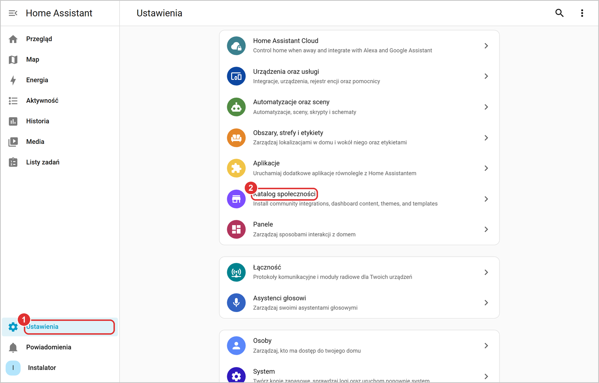

Przy pierwszym wejściu Home Assistant pokaże ostrzeżenie o dodatkach tworzonych przez społeczność.
Zaznacz **Rozumiem ryzyko i zgadzam się** (1) i kliknij **Kontynuuj** (2).

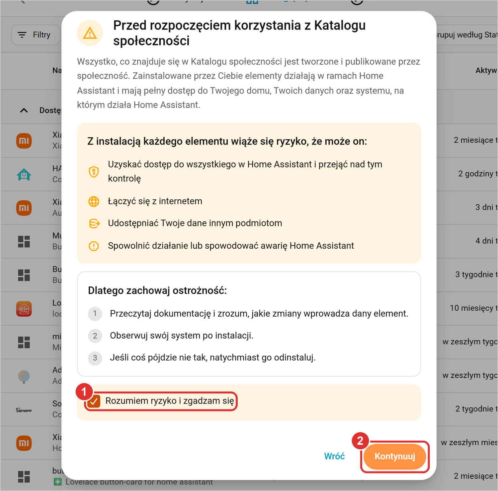

## Krok 2. Wklej link

Kliknij **Dodaj z linku** w prawym górnym rogu.

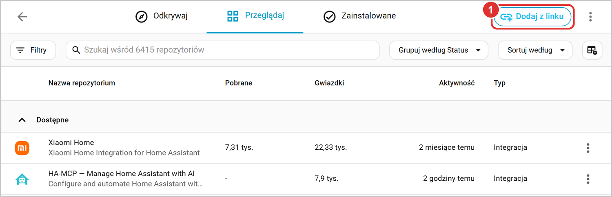

Wklej skopiowany link w pole **Link do GitHub** (1) i kliknij **Utwórz** (2).

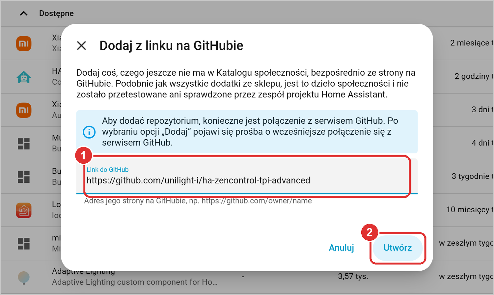

## Krok 3. Połącz Home Assistanta z GitHubem (tylko za pierwszym razem)

Jeśli robisz to pierwszy raz, pojawi się okno **Connect GitHub**. Jest po angielsku: informuje, że
Home Assistant musi połączyć się z GitHubem, żeby pobierać dodatki z linku. Nie podajesz w nim hasła.
Kliknij **Continue**.

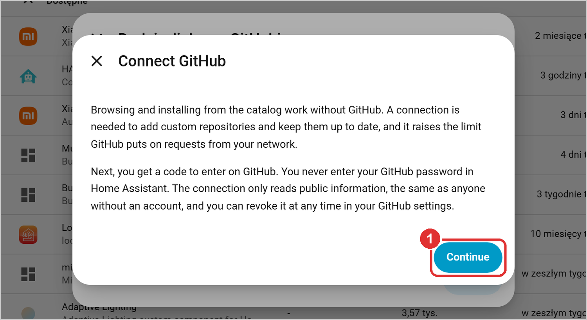

Home Assistant pokaże jednorazowy kod.

1. Kliknij link `https://github.com/login/device` (1). Otworzy się strona GitHuba.
2. Zaloguj się na GitHubie, wpisz kod z okna (2) i kliknij **Continue**, a potem **Authorize**.
3. Wróć do karty z Home Assistantem. Okno zamknie się samo po kilku sekundach.

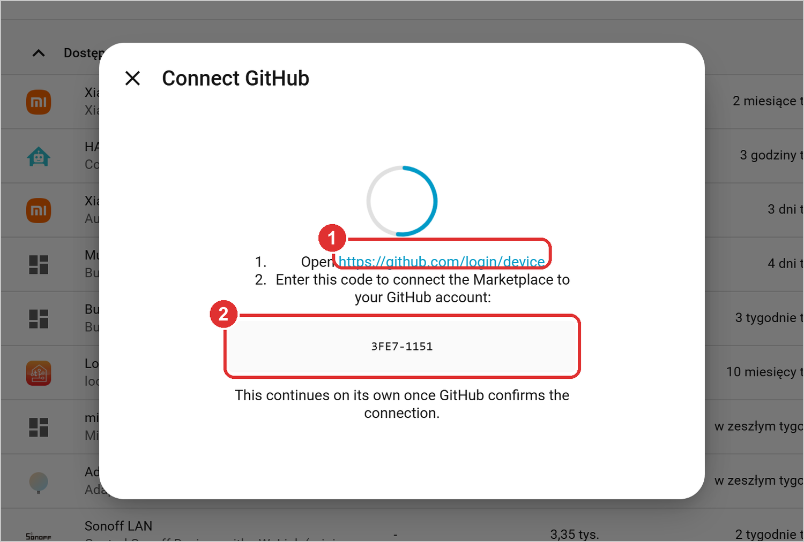

> Kod jest ważny 15 minut. Nie zamykaj w tym czasie okna z kodem ani karty z Home Assistantem:
> zamknięcie przerywa połączenie i trzeba zacząć krok 2 od nowa.

## Krok 4. Zainstaluj integrację

Otworzy się strona **zencontrol TPI Advanced (Unilight)**. Kliknij **Zainstaluj**.

Jeśli strona nie otworzyła się sama, wpisz `zencontrol` w wyszukiwarkę Katalogu społeczności i wybierz
pozycję z dopiskiem **(Unilight)**.

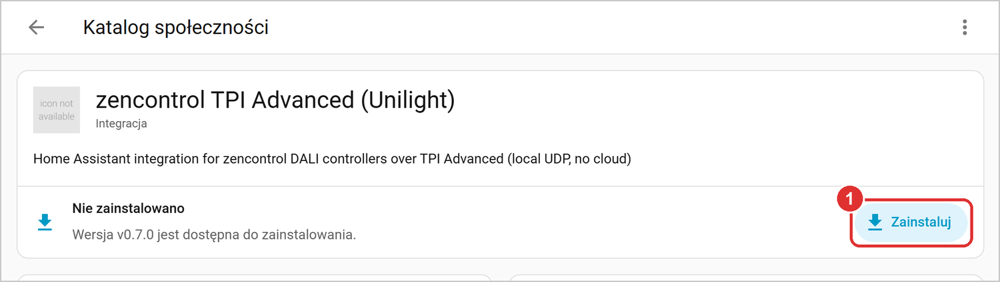

Potwierdź przyciskiem **Zainstaluj**.

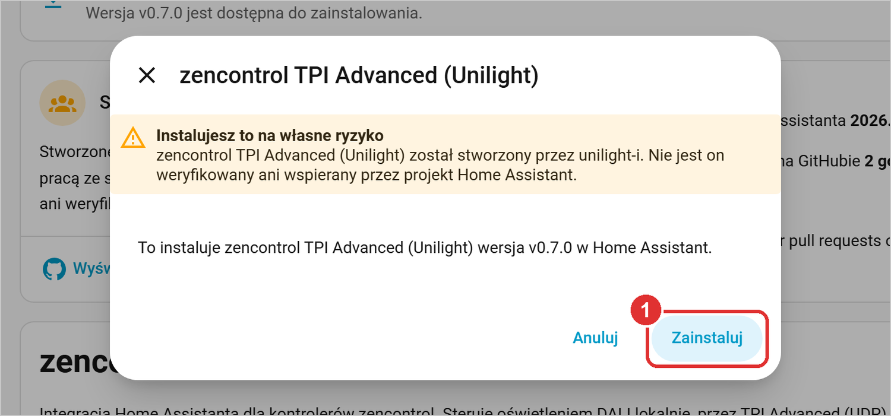

## Krok 5. Wybierz kontroler

Po instalacji Home Assistant sam wyszukuje kontrolery w sieci i pokazuje ich listę.
Zaznacz swój kontroler (1) i kliknij **Zatwierdź** (2).

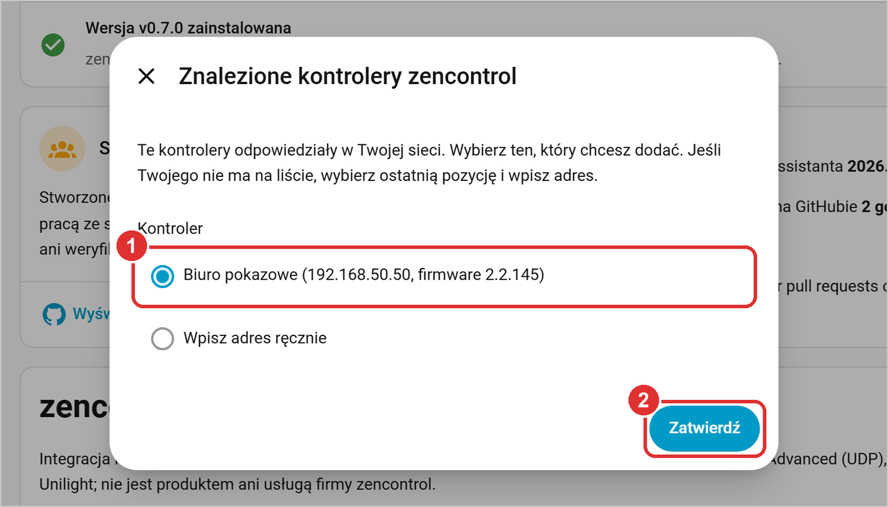

Home Assistant pokaże znalezione oprawy i grupy. Możesz od razu przypisać je do pomieszczeń albo zrobić to
później: kliknij **Pomiń i zakończ**.

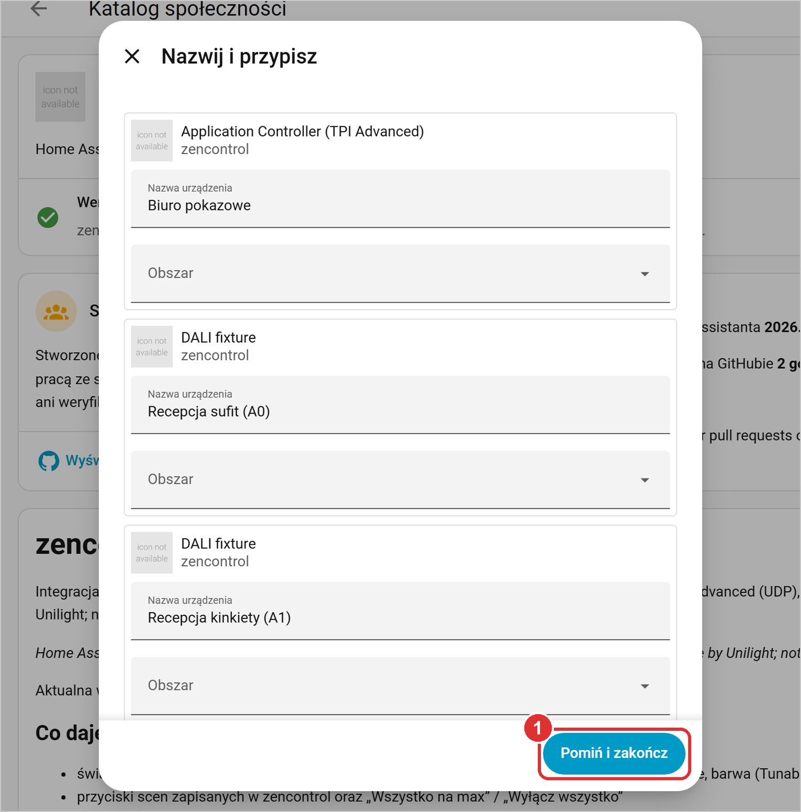

Gotowe. Każda nazwana oprawa i każda grupa z zencontrol jest teraz światłem w Home Assistant.

**Lista się nie pojawiła?** Kliknij **Konfiguracja** na stronie integracji albo wejdź w
Ustawienia → Urządzenia oraz usługi → **Dodaj integrację** i wpisz `zencontrol`.

**Zamiast listy widzisz „Nie znaleziono kontrolera automatycznie”?** Tak bywa, gdy Home Assistant działa
w Dockerze albo w maszynie wirtualnej. Wpisz adres IP kontrolera. Jeśli go nie znasz, wpisz trzy pierwsze
liczby adresu swojej sieci, na przykład `192.168.1` (takie same jak w adresie routera): Home Assistant
przeszuka ją i pokaże listę.

**Twojego kontrolera nie ma na liście?** Wybierz **Wpisz adres ręcznie** i podaj adres IP kontrolera
albo trzy pierwsze liczby adresu sieci, w której jest kontroler.
Zobacz też [Gdy coś nie działa](#gdy-coś-nie-działa).

## Gdzie to potem znaleźć

Ustawienia → Urządzenia oraz usługi → **zencontrol TPI Advanced (Unilight)**. Zobaczysz kontroler oraz
wszystkie oprawy i grupy. Koło zębate (1) otwiera ustawienia integracji.

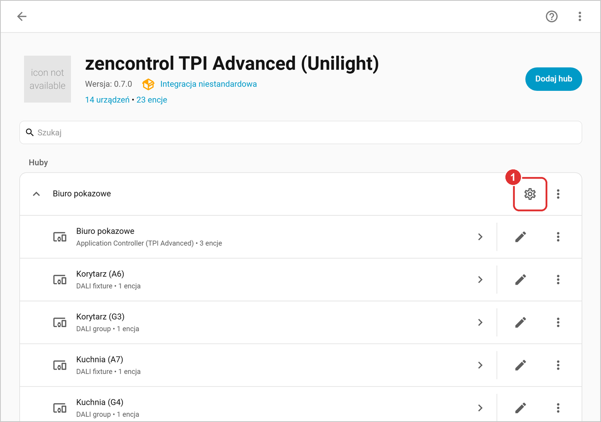

## Czujniki ruchu i klawisze paneli (opcjonalnie)

Czujniki ruchu i klawisze paneli ściennych są domyślnie ukryte. Żeby używać ich w automatyzacjach:

1. Kliknij koło zębate na stronie integracji (zrzut powyżej).
2. Zaznacz **Pokaż czujniki ruchu** (1) i **Pokaż klawisze paneli ściennych** (2).
3. Kliknij **Zatwierdź** (3).

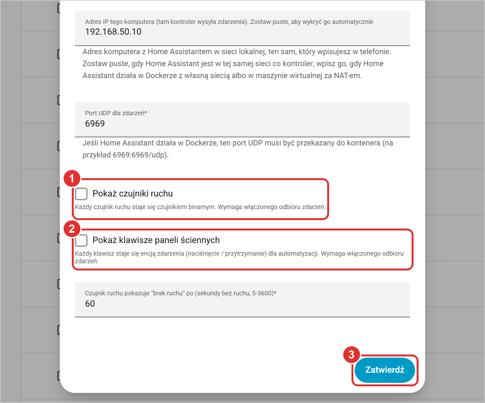

Pozostałych pól nie trzeba zmieniać.

## Gdy coś nie działa

| Co widzisz | Co zrobić |
|---|---|
| Kontrolera nie ma na liście | Sprawdź, czy Home Assistant i kontroler są w tej samej sieci. Jeśli Home Assistant działa w Dockerze albo w maszynie wirtualnej, wybierz „Wpisz adres ręcznie” i podaj adres IP kontrolera albo trzy pierwsze liczby adresu sieci (np. `192.168.1`). |
| Nie znam adresu IP kontrolera | W polu adresu wpisz trzy pierwsze liczby adresu swojej sieci (np. `192.168.1`), a Home Assistant ją przeszuka. Możesz też zobaczyć listę urządzeń w routerze albo uruchomić `ZNAJDZ_KONTROLER.bat` z folderu [`tools`](../tools/) na komputerze w tej samej sieci. |
| „Kontroler nie odpowiada” | Zły adres IP, inna sieć albo wyłączone TPI na kontrolerze. |
| „Kontroler odpowiedział PAID_FEATURE” | Kontroler nie ma licencji TPI Advanced. Skontaktuj się ze sprzedawcą. |
| GitHub pokazuje „Expired user code” | Kod wygasł albo okno z kodem zostało zamknięte. Wróć do kroku 2 i użyj nowego kodu. |
| Home Assistant prosi o ponowne uruchomienie | Zgódź się. Dzieje się tak głównie przy aktualizacji integracji. |
| Światła działają, ale stan odświeża się z opóźnieniem | Zdarzenia z kontrolera nie docierają. W ustawieniach integracji włącz „Odbieraj zdarzenia z kontrolera”. W Dockerze wpisz tam adres IP komputera z Home Assistantem i przekaż do kontenera port UDP 6969 (każdy kolejny kontroler używa następnego: 6970, 6971...). |

Nie pomogło? [Zgłoś problem](https://github.com/unilight-i/ha-zencontrol-tpi-advanced/issues) i podaj wersję
Home Assistanta, firmware kontrolera oraz fragment logu (Ustawienia → System → Logi, szukaj `zencontrol`).

## Aktualizacje

Nowe wersje integracji pojawiają się w Home Assistancie jako zwykła aktualizacja (Ustawienia, na górze strony).
Niczego nie trzeba wklejać ponownie.

---

Zrzuty ekranu pochodzą z Home Assistanta 2026.11.1 i pokazują przykładową instalację.
